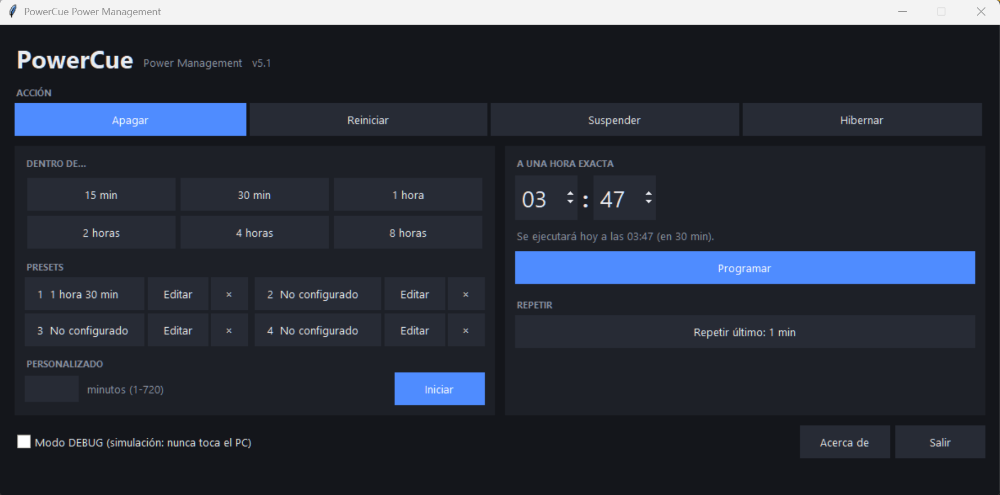

# PowerCue Power Management

Programa que apaga, reinicia, suspende o hiberna tu equipo cuando tú quieras: dentro de un rato (por ejemplo 45 minutos) o a una hora exacta (por ejemplo 23:30). Útil para dejar una película, una descarga o un respaldo terminando y que el equipo se apague solo.



Versión actual: **5.1**. Desarrollo principal en Windows; también se usa en Linux.
Historial de nombres: «proyect shutdown» → PowerTimer → PowerCue. Autor original: Patomoi.

## Instalación

Descarga el archivo que corresponda desde la sección **Releases** del repositorio.

| Si usas… | Descarga | Cómo abrirlo |
|---|---|---|
| **Windows**, sin experiencia técnica | `PowerCue-<version>-windows.zip` | Extrae **todo** el contenido en una carpeta y abre `PowerCue.bat` con doble clic. Ventana gráfica; no instala nada. |
| **Windows**, si prefieres la consola | `powercue.bat` | Doble clic, o desde cmd: `powercue.bat 45`. Un solo archivo. |
| **Linux** | `powercue.sh` | `chmod +x powercue.sh` y luego `./powercue.sh`. Requiere bash 4+ y el `date` de GNU. |
| **Python** | `powercue.pyw` | Solo si ya tienes Python 3.8 o superior con tkinter: doble click o desde CMD/terminal: `python powercue.pyw`. Funciona en Windows y Linux, requiere instalar Python 3.8+ y tkinter |

En Windows no necesitas instalar nada más: la versión gráfica usa PowerShell, que ya viene con Windows 10 y 11.

### Aviso de Windows

La primera vez puede aparecer «Windows protegió su PC», porque los archivos no están firmados.
Pulsa **Más información** y luego **Ejecutar de todas formas**.
Cada release incluye `SHA256SUMS.txt` para verificar la descarga.

## Uso básico

1. Elige la **acción**: apagar, reiniciar, suspender o hibernar (se recuerda la última).
2. Elige **cuándo**:
   - uno de los 6 botones rápidos (15 min, 30 min, 1 h, 2 h, 4 h, 8 h),
   - uno de tus 4 **presets**,
   - un tiempo **personalizado** (hasta 720 min, es decir 12 horas),
   - o una **hora exacta** (hoy o mañana). También puedes **repetir el último** tiempo usado.
3. Durante la cuenta regresiva ves el progreso y puedes **restar 5 min, sumar 5 o sumar 15**, o **cancelar**.
4. El programa avisa a los **5 minutos** y al **minuto** final.
5. Al llegar a cero hay un **aviso final de 30 segundos** donde puedes **posponer 5 minutos** o **cancelar** antes de que se ejecute la acción.

Si cierras la ventana con un temporizador en marcha, el programa pregunta antes. Al salir, el temporizador se cancela y el PC no se toca.

### Modo DEBUG

Simula todo y **nunca toca el PC**. Siempre arranca desactivado.

## Línea de comandos

Sin argumentos abre el menú o la ventana. Con TIEMPO, preset o repetir, programa de inmediato.

```
TIEMPO        45, 45m, 2h, 1h30, 1h30m (duración, 1 min a 12 h) o 23:30 (hora exacta)
--accion ACC  (-a)  apagar (por defecto), reiniciar, suspender, hibernar
--preset N    (-p)  usa el preset N (1-4)
--repetir     (-r)  repite el último tiempo
--debug       (-d)  simulación
--segundos N        duración en segundos, solo pruebas, requiere --debug
--ayuda (-h), --version (-v)
```

Solo se admite uno entre TIEMPO, preset, repetir y segundos.
En PowerShell los nombres son `-Accion`, `-Preset`, `-Repetir`, `-ModoDebug`, `-Segundos`, `-Ayuda`, `-Version`.
Códigos de salida (versiones de texto): `0` terminó, `1` cancelado, `2` argumentos inválidos.

Ejemplos:

```
./powercue.sh 1h30 --accion suspender
powercue.bat 23:30
powercue-gui.bat -Preset 2 -ModoDebug
```

En el zip de Windows, el lanzador de la versión gráfica es `PowerCue.bat` (por ejemplo, `PowerCue.bat 45 -Accion suspender`).

## Configuración

Tus presets y la última acción se guardan en:

- Windows: `%APPDATA%\PowerCue\`
- Linux: `~/.config/PowerCue/`

`presets.ini` (`preset1=45` … `preset4=`, en minutos; vacío = sin configurar) y `settings.ini` (`accion=apagar`, `ultimo=m:45` o `ultimo=h:23:30`).

Para desinstalar en Windows, borra la carpeta del programa y la carpeta de configuración.

## Preguntas frecuentes

**«Suspender» hiberna mi equipo.** En Windows, si la hibernación está activada, «suspender» puede terminar hibernando.

**«Hibernar» da error.** La hibernación puede estar desactivada. Actívala con `powercfg /hibernate on` en una consola de administrador.

**La ventana se ve algo borrosa.** La versión de PowerShell no ajusta el escalado en pantallas de alta resolución.

**`powercue.bat` y el horario de verano.** Usa solo la hora del reloj, así que un cambio de horario durante la cuenta la desplaza una hora. Además, una espera mayor a unas 23 h 50 min se acorta unos minutos, y no muestra tildes.

**macOS.** Hay soporte básico en la versión de Python (sin hibernar), sin probar.

Más detalles en [`docs/NOTAS-DE-DESARROLLO.md`](docs/NOTAS-DE-DESARROLLO.md).

## Para desarrolladores

### Versiones

| Carpeta | Archivo | Qué es | Requisitos |
|---|---|---|---|
| `src/python/` | `powercue.pyw` | GUI en Python, versión principal y portable | Python 3.8 o superior con tkinter (Windows y Linux; macOS básico, sin hibernar) |
| `src/powershell/` | `powercue.ps1` | GUI nativa de Windows (WinForms) | PowerShell 5.1. Guardar como UTF-8 con BOM y CRLF |
| `src/powershell/` | `powercue-gui.bat` | Lanzador del `.ps1`; reenvía los argumentos | Debe estar junto a `powercue.ps1` |
| `src/batch/` | `powercue.bat` | Versión de texto para Windows (ASCII, sin tildes) | Windows |
| `src/shell/` | `powercue.sh` | Versión de texto para Linux | bash 4+ y `date` de GNU |

Las cuatro comparten sintaxis de línea de comandos y archivos de configuración.
El lanzador de PowerShell se llama `powercue-gui.bat` en el repositorio para no chocar con `powercue.bat` (versión de texto); en el zip de Windows se llama `PowerCue.bat` y `powercue.ps1` va en la carpeta `lib\`.

### Generar los archivos de descarga

```
python tools/empaquetar.py
```

Deja todo en `dist/`, comprueba que la versión coincida en las cuatro versiones y muestra el comando para publicar la Release.

### Codificación y finales de línea

`.gitattributes` fuerza CRLF en `.bat` y `.ps1`, y LF en `.sh`, `.py` y `.pyw`.
`powercue.ps1` debe conservar UTF-8 **con BOM**: algunos editores lo quitan al guardar.

## Historial

Las versiones anteriores están en [`archive/`](archive/README.md).

## Licencia

[MIT](LICENSE)
